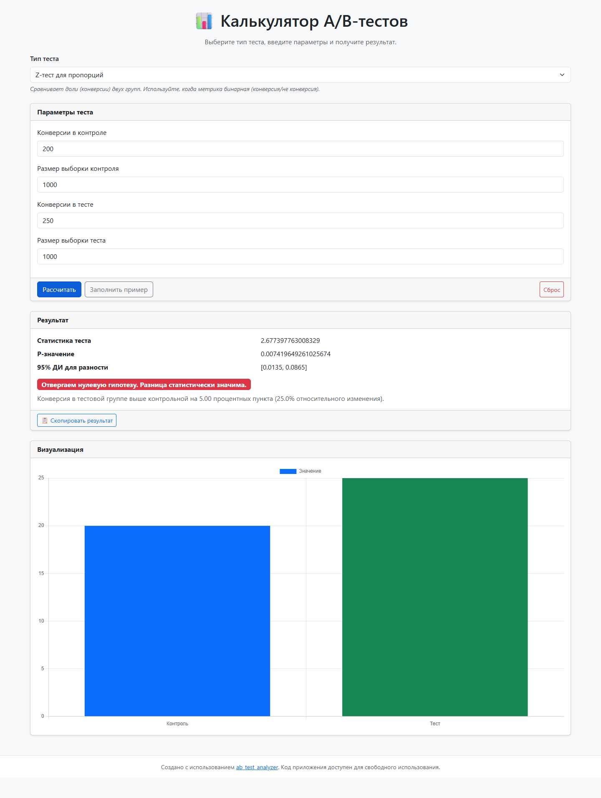
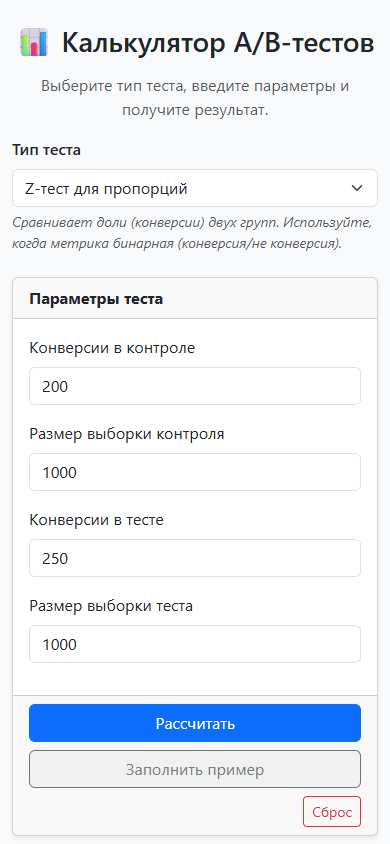

# A/B Test Calculator

Compare conversion rates or group means, check experiment allocation, and estimate the smallest conversion lift an experiment can detect. The browser offers a built-in example for each analysis and shows an interpretation, with a chart where applicable.

[Try the live demo on Render](https://abcalculator.onrender.com/) · [Statistical library on PyPI](https://pypi.org/project/ab-test-analyzer/)

## What I built

I'm Pavel Fomin. I built the Flask application and published its statistical engine, [`ab-test-analyzer` on PyPI](https://pypi.org/project/ab-test-analyzer/), as a reusable Python package. The app adds a responsive Russian-language interface, input validation, and charts around the library. I also set up the Render deployment and automated checks for browser behavior, accessibility, and experiment-data logging.

## Production screenshots

The built-in two-proportion example, captured on the Render deployment.

**Desktop · 1440 px**



**Mobile · 390 px**



## How it works

```text
Browser form → Flask POST /calculate on Render → ab_test_analyzer
Browser result and chart ← JSON response ← Flask formats the result
```

[`app.py`](app.py) serves the Jinja page from [`templates/`](templates/) and handles the API. [`static/script.js`](static/script.js) builds the fields for the selected method and sends `{test_type, params}` as JSON over HTTPS. Flask parses and validates those values, calls the Python library, and returns the result or a validation error. Flask also computes confidence intervals for proportion and mean differences with NumPy and SciPy. The browser renders the response and draws charts with Chart.js.

Aggregate inputs such as counts, sample sizes, means, and standard deviations reach Flask and Render. The application processes them in memory, stores no calculation history, and has no product telemetry. The policy explains what hosting and CDN providers can see and which data must stay out of logs. [Data-handling policy](docs/PRIVACY.md) · [Decision in issue #6](https://github.com/FominP/ABCalculator/issues/6)

## Statistical methods

| Method | Use it to | Important limitation |
| --- | --- | --- |
| Two-proportion Z test | Compare conversion rates and estimate their absolute difference with a 95% confidence interval. | The normal approximation needs enough conversions and non-conversions in both groups. |
| Welch's t-test | Compare means from group sizes, means, and standard deviations, with a 95% confidence interval for the difference. | Allows unequal variances. Small samples with heavily skewed outcomes can make inference unreliable. |
| Pearson chi-square test | Test association between group and outcome in a 2 × 2 conversion table. | The chi-square approximation can be unreliable when expected cell counts are small. |
| Sample ratio mismatch (SRM) | Check observed group sizes against the planned allocation. | A significant mismatch flags an allocation problem for investigation. |
| Minimum detectable effect (MDE) | Estimate detectable absolute and relative conversion lift from baseline, sample sizes, alpha, and power. | This is a planning estimate and depends on the supplied assumptions. |

Use independent observations and a planned analysis. The four hypothesis tests use a 5% significance threshold. The calculator takes aggregate inputs and does not adjust for repeated looks, multiple comparisons, or clustered observations.

## Run locally

Use Python 3.12 to match Render and GitHub Actions.

```sh
git clone https://github.com/FominP/ABCalculator.git
cd ABCalculator
python -m venv venv
```

Activate the environment with `source venv/bin/activate` on macOS or Linux, or `.\venv\Scripts\Activate.ps1` in PowerShell. Then run:

```sh
python -m pip install -r requirements.txt
python app.py
```

Open [http://127.0.0.1:5000/](http://127.0.0.1:5000/).

## Tests and quality checks

With the virtual environment active, run the full Python suite from the repository root:

```sh
python -m pip install -r requirements.txt -r requirements-dev.txt
python -m playwright install chromium
python -m pytest
```

| File | Coverage |
| --- | --- |
| [`tests/test_flask_smoke.py`](tests/test_flask_smoke.py) | Fast Flask test-client checks for `/`, `/healthz`, and valid example payloads for all five calculation modes. |
| [`tests/test_privacy.py`](tests/test_privacy.py) | Flask test client checks that experiment input and result markers do not reach Python logs, stdout, or stderr. Runs without a browser. |
| [`tests/e2e/conftest.py`](tests/e2e/conftest.py) | Starts Flask on a free local port, waits for `/healthz`, and provides isolated Chromium contexts. Set `PLAYWRIGHT_BASE_URL` to target a running deployment. |
| [`tests/e2e/test_browser_smoke.py`](tests/e2e/test_browser_smoke.py) | Checks all five forms, a real two-proportion submission and chart, invalid input, malformed responses, and the 390 px layout. |
| [`tests/e2e/test_accessibility.py`](tests/e2e/test_accessibility.py) | Runs axe-core on the initial and result views and checks keyboard operation, field labels, validation messages, and live regions. |

For a quick server-side check, run `python -m pytest tests/test_flask_smoke.py tests/test_privacy.py`. The [Flask smoke workflow](.github/workflows/flask-smoke.yml) runs for pull requests and pushes to `main`. The [browser workflow](.github/workflows/browser-tests.yml) runs the browser suite and a separate Lighthouse audit against local Flask. The [production workflow](.github/workflows/production-quality.yml) warms up Render before running its scheduled or manually triggered audit.

## Deploy to Render

Create a **Blueprint** in Render and connect this repository's `main` branch. [`render.yaml`](render.yaml) defines a free Python web service in Frankfurt. Render installs `requirements.txt`, starts `gunicorn app:app --bind 0.0.0.0:$PORT --timeout 120`, checks `GET /healthz`, and redeploys when a commit lands on the connected branch.

Render can spin down the free service after 15 minutes of inactivity. The next visit may show a loading page and take around a minute. [Render free-tier behavior](https://render.com/docs/free#spinning-down-on-idle) · [Production verification in issue #2](https://github.com/FominP/ABCalculator/issues/2)

## Refresh the screenshots

1. Open the [live Render deployment](https://abcalculator.onrender.com/) and wait for the calculator to load.
2. At 1440 × 1000, choose the two-proportion Z test, click **Заполнить пример** (fill example), then **Рассчитать** (calculate). Wait for the chart to finish drawing and save a full-page PNG as `docs/screenshots/desktop.png`.
3. At 390 × 844, fill the same example and capture the visible form before submitting it. Save the viewport PNG as `docs/screenshots/mobile.png`.
4. Preview the README on GitHub and check that both images load and remain readable.
